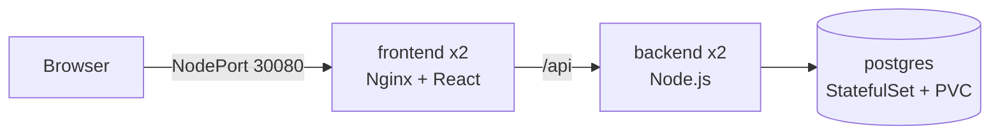

# Swiggy DevSecOps Infra

Infrastructure and deployment configuration for [swiggy-devsecops-app](https://github.com/paighanutkarsh2410-lab/swiggy-devsecops-app).

Keeping deployment config apart from application code means the Git history of this repo is the history of what was deployed. This becomes the GitOps source of truth when Argo CD is added.

## Layout

| Path | Purpose |
|---|---|
| `k8s/base` | Kubernetes manifests shared by every environment |
| `k8s/overlays/kind` | Local cluster settings: image tags, NodePort, secrets |
| `kind/cluster.yaml` | Local kind cluster definition |
| `scripts/kind-up.sh` | Creates the cluster and deploys the app |
| `terraform/aws` | AWS network and EC2 server for K3s |
| `ansible` | Server hardening and K3s installation |

Each tool has one job:

| Tool | Job |
|---|---|
| Terraform | Creates the server and its network in AWS |
| Ansible | Configures the server and installs K3s |
| Kubernetes | Runs and heals the application |

## Architecture



## Security

- The `swiggy` namespace enforces the `restricted` Pod Security Standard.
- Every container runs as non-root with a read-only root filesystem, no privilege escalation, all Linux capabilities dropped and the `RuntimeDefault` seccomp profile.
- Network policies deny all incoming traffic by default. Only the frontend accepts outside traffic, only the frontend can reach the backend, and only the backend can reach PostgreSQL.
- Service account tokens are not mounted, because no pod talks to the Kubernetes API.
- Secrets are generated locally into `secrets.env`, which is never committed.
- The EC2 server requires IMDSv2, encrypts its disk, and only accepts SSH and Kubernetes API traffic from one admin address.
- Ansible disables root and password SSH logins, and turns on automatic security updates.
- K3s is installed from a pinned release with its checksum verified, and encrypts Kubernetes Secrets at rest.
- CI validates the Kubernetes manifests with kubeconform, checks Terraform formatting and validity, lints Ansible at the `production` profile, and fails on any HIGH or CRITICAL Trivy misconfiguration.

## Run locally

You need Docker, [kind](https://kind.sigs.k8s.io) and kubectl.

```bash
./scripts/kind-up.sh
```

The script creates a `swiggy` cluster, generates random secrets on first run, deploys everything and waits for it to be ready. The website is then at http://localhost:8081.

To create a restaurant staff account:

```bash
kubectl -n swiggy exec deploy/backend -- env \
  STAFF_NAME="Spice Garden Staff" \
  STAFF_EMAIL="staff@example.com" \
  STAFF_PASSWORD="choose-a-password" \
  STAFF_RESTAURANT_ID=1 \
  node src/scripts/createStaff.js
```

To delete the cluster:

```bash
kind delete cluster --name swiggy
```

## Deploy to AWS

This creates real AWS resources that can cost money. Set up an AWS budget alert first, and run `terraform destroy` when you finish each session.

You need Terraform, Ansible and AWS credentials for an IAM user, not the root account.

### Create a limited IAM user

[`terraform/aws/iam-policy.json`](terraform/aws/iam-policy.json) gives Terraform only what this project needs:

- EC2 and VPC actions in `ap-south-1` (Mumbai) only.
- Read access to the one public SSM parameter that holds the Amazon Linux AMI ID.
- No IAM, billing or account permissions.
- New servers must be `t3.micro` or `t3.small`, and cannot be resized to anything larger.
- Unencrypted disks are refused.

In the IAM console:

1. **Policies → Create policy → JSON**, paste the file's contents and name it `swiggy-terraform`.
2. **Users → Create user** named `swiggy-terraform`, with no console access. Attach the `swiggy-terraform` policy.
3. Open the user, then **Security credentials → Create access key → Command Line Interface**.

On the machine that runs Terraform, store the key yourself. Never paste it into a chat, a file in this repo or a ticket.

```bash
aws configure --profile swiggy
export AWS_PROFILE=swiggy
aws sts get-caller-identity
```

Delete the access key in the IAM console when you no longer need it.

### Create the server

```bash
cd terraform/aws
cp terraform.tfvars.example terraform.tfvars
```

Set `admin_cidr` to your own public IP with `/32`, and `ssh_public_key` to your public key. Then:

```bash
terraform init
terraform plan
terraform apply
```

Configure the server and install K3s:

```bash
export SWIGGY_SERVER_IP="$(terraform output -raw server_public_ip)"
cd ../../ansible
ansible-playbook playbooks/site.yml
```

Remove everything when you are done:

```bash
cd ../terraform/aws
terraform destroy
```

Terraform state is stored locally and is never committed. It describes your AWS resources, so keep it safe.

## Deploying a new version

Images are built and scanned by the app repo's CI and published to GHCR, tagged with the commit SHA. To deploy a new version, update `newTag` in `k8s/overlays/kind/kustomization.yaml` and apply the overlay again.

## Database schema

`k8s/base/db/init.sql` is a copy of `backend/db/init.sql` from the app repo. It only runs when the database volume is first created.
