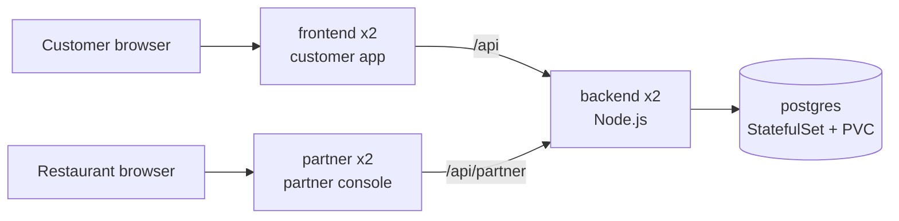

# Swiggy DevSecOps Infra

Infrastructure and deployment configuration for [swiggy-devsecops-app](https://github.com/paighanutkarsh2410-lab/swiggy-devsecops-app).

Keeping deployment config apart from application code means the Git history of this repo is the history of what was deployed. This becomes the GitOps source of truth when Argo CD is added.

## Layout

| Path | Purpose |
|---|---|
| `k8s/base` | Kubernetes manifests shared by every environment |
| `k8s/overlays/kind` | Local cluster settings: image tags, NodePorts for both websites, secrets |
| `kind/cluster.yaml` | Local kind cluster definition |
| `k8s/overlays/aws` | K3s on EC2 settings: image tags, Traefik host routing, secrets |
| `scripts/kind-up.sh` | Creates the cluster and deploys the app |
| `scripts/aws-up.sh`, `aws-down.sh`, `aws-status.sh` | Create, destroy and check the whole AWS environment |
| `scripts/aws-deploy.sh` | Deploys the app to the K3s server on EC2 |
| `docs/aws-deployment.md` | Record of a deployment to AWS, with screenshots |
| `terraform/aws` | AWS network and EC2 server for K3s |
| `ansible` | Server hardening and K3s installation |

Each tool has one job:

| Tool | Job |
|---|---|
| Terraform | Creates the server and its network in AWS |
| Ansible | Configures the server and installs K3s |
| Kubernetes | Runs and heals the application |

## Architecture

Two separate websites share one API: the customer app and the restaurant partner console.



| Environment | Customer app | Partner console |
|---|---|---|
| kind | NodePort 30080, http://localhost:8081 | NodePort 30082, http://localhost:8083 |
| AWS (K3s + Traefik) | `http://<server-ip>` | `http://partner.<server-ip-with-dashes>.sslip.io` |

On AWS, Traefik routes by host name. [sslip.io](https://sslip.io) resolves names like `partner.13-55-152-184.sslip.io` to the IP inside them, so host-based routing works without buying a domain.

## Security

- The `swiggy` namespace enforces the `restricted` Pod Security Standard.
- Every container runs as non-root with a read-only root filesystem, no privilege escalation, all Linux capabilities dropped and the `RuntimeDefault` seccomp profile.
- Network policies deny all incoming traffic by default. Only the two websites accept outside traffic, only they can reach the backend, and only the backend can reach PostgreSQL.
- Service account tokens are not mounted, because no pod talks to the Kubernetes API.
- Secrets are generated locally into `secrets.env`, which is never committed.
- The EC2 server requires IMDSv2, encrypts its disk, and only accepts SSH and Kubernetes API traffic from one admin address.
- Ansible disables root and password SSH logins, and turns on automatic security updates.
- K3s is installed from a pinned release with its checksum verified, and encrypts Kubernetes Secrets at rest.
- CI validates the Kubernetes manifests with kubeconform, checks Terraform formatting and validity, lints Ansible at the `production` profile, and fails on any HIGH or CRITICAL Trivy misconfiguration.

## Run locally

You need Docker, [kind](https://kind.sigs.k8s.io) and kubectl.

```bash
./scripts/kind-up.sh
```

The script creates a `swiggy` cluster, generates random secrets on first run, deploys everything and waits for it to be ready. The customer app is then at http://localhost:8081 and the partner console at http://localhost:8083.

A cluster created before the partner console existed has no port mapping for it. Recreate it with `kind delete cluster --name swiggy` and run the script again.

To create a restaurant partner account (add `STAFF_ROLE=OWNER` for an owner):

```bash
kubectl -n swiggy exec deploy/backend -- env \
  STAFF_NAME="Spice Garden Staff" \
  STAFF_EMAIL="staff@example.com" \
  STAFF_PASSWORD="choose-a-password" \
  STAFF_RESTAURANT_ID=1 \
  node src/scripts/createStaff.js
```

To delete the cluster:

```bash
kind delete cluster --name swiggy
```

## Deploy to AWS

This creates real AWS resources that can cost money. Set up an AWS budget alert first, and take the environment down when you finish each session.

[docs/aws-deployment.md](docs/aws-deployment.md) records a full deployment, with screenshots and command output.

### Quick start

Once the IAM user below is set up, three commands run everything from the repository root:

| Command | What it does |
|---|---|
| `./scripts/aws-up.sh` | Shows the Terraform plan and asks for `yes`, then creates the server, runs Ansible and deploys the app. Prints the website address. About 10 minutes. |
| `./scripts/aws-status.sh` | Says whether anything is running in AWS and whether the website answers. |
| `./scripts/aws-down.sh` | Shows what Terraform will destroy and asks for `yes`, destroys it, then checks that nothing tagged for this project is left. |

Add `-y` to `aws-up.sh` or `aws-down.sh` to skip the question. Each run of `aws-up.sh` sets the SSH and Kubernetes API rule to your current public IP, so run it again if your IP changes.

You need the AWS CLI, Terraform, Ansible and kubectl, plus AWS credentials for an IAM user, not the root account. The scripts use the `swiggy` AWS profile and the SSH key `~/.ssh/swiggy-aws`, which `aws-up.sh` creates if it is missing. Set `AWS_PROFILE` or `SSH_KEY` to use others.

The sections below explain each step the scripts run.

### Create a limited IAM user

[`terraform/aws/iam-policy.json`](terraform/aws/iam-policy.json) gives Terraform only what this project needs:

- EC2 and VPC actions in `ap-southeast-2` (Sydney) only. The AWS Free plan organization this account belongs to blocks other regions with a service control policy that the account cannot change. Dry runs confirmed Mumbai and Singapore are denied and Sydney is allowed.
- Read access to the one public SSM parameter that holds the Amazon Linux AMI ID.
- No IAM, billing or account permissions.
- New servers must be `t3.micro` or `t3.small`, and cannot be resized to anything larger.
- Unencrypted disks are refused.

In the IAM console:

1. **Policies → Create policy → JSON**, paste the file's contents and name it `swiggy-terraform`.
2. **Users → Create user** named `swiggy-terraform`, with no console access. Attach the `swiggy-terraform` policy.
3. Open the user, then **Security credentials → Create access key → Command Line Interface**.

On the machine that runs Terraform, store the key yourself. Never paste it into a chat, a file in this repo or a ticket.

```bash
aws configure --profile swiggy
export AWS_PROFILE=swiggy
aws sts get-caller-identity
```

Delete the access key in the IAM console when you no longer need it.

### Create the server

```bash
cd terraform/aws
cp terraform.tfvars.example terraform.tfvars
```

Set `admin_cidr` to your own public IP with `/32`, and `ssh_public_key` to your public key. Then:

```bash
terraform init
terraform plan
terraform apply
```

Configure the server and install K3s:

```bash
export SWIGGY_SERVER_IP="$(terraform output -raw server_public_ip)"
cd ../../ansible
ansible-playbook playbooks/site.yml
```

Deploy the app. The script renders `k8s/overlays/aws` locally and applies it over SSH, so it needs `kubectl` on your machine but not access to port 6443:

```bash
cd ..
./scripts/aws-deploy.sh
```

K3s's built-in Traefik serves the website on port 80 of the server. The script generates `k8s/overlays/aws/secrets.env` on first run. Keep it while the server exists: a new file would change the database password and lock the backend out of the existing database. `aws-down.sh` deletes it, because the database goes with the server.

Remove everything when you are done:

```bash
cd terraform/aws
terraform destroy
```

Terraform state is stored locally and is never committed. It describes your AWS resources, so keep it safe.

## Deploying a new version

Images are built and scanned by the app repo's CI and published to GHCR, tagged with the commit SHA. To deploy a new version, update `newTag` in `k8s/overlays/kind/kustomization.yaml` or `k8s/overlays/aws/kustomization.yaml` and apply the overlay again.

## Database schema

`k8s/base/db/init.sql` is a copy of `backend/db/init.sql` from the app repo. It only runs when the database volume is first created.

An existing database does not rerun `init.sql`. To upgrade one in place, run the app repo's migrations in order. Each is safe to run more than once:

```bash
kubectl -n swiggy exec -i postgres-0 -- sh -c 'psql -U "$POSTGRES_USER" -d "$POSTGRES_DB"' < backend/db/migrations/002_partner_console.sql
```

On AWS this is never needed, because each `aws-up.sh` starts with a new database.
