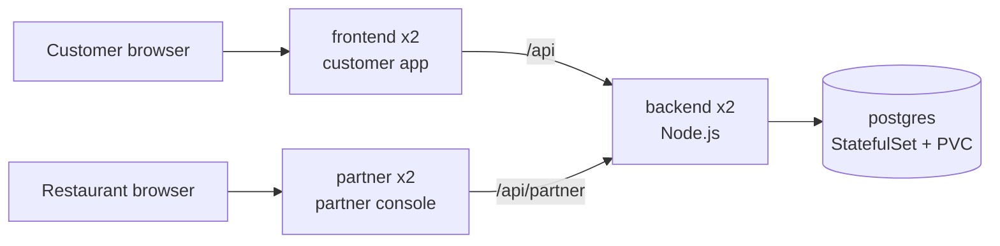
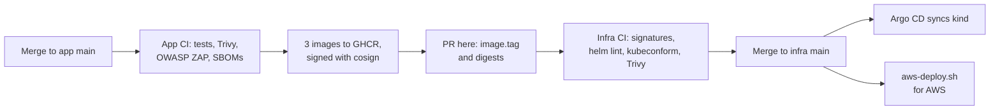
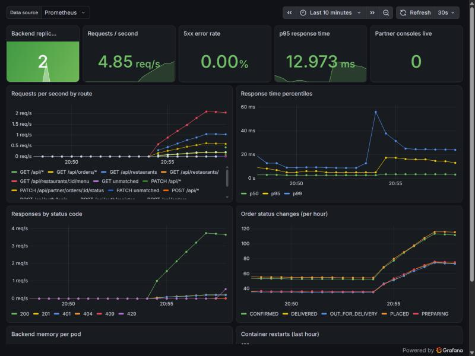

# Swiggy DevSecOps Infra

Infrastructure and deployment configuration for [swiggy-devsecops-app](https://github.com/paighanutkarsh2410-lab/swiggy-devsecops-app).

This repository is the GitOps source of truth: what is on `main` here is what runs. Argo CD watches it and keeps the cluster in line, so the Git history of this repo is the history of every deployment, and rolling back is a `git revert`.

## Layout

| Path | Purpose |
|---|---|
| `charts/swiggy` | Helm chart for the whole app: customer app, partner console, API, PostgreSQL, network policies, ingress |
| `charts/swiggy/values-kind.yaml` | Local kind settings: image tag and digests, NodePorts |
| `charts/swiggy/values-aws.yaml` | K3s on EC2 settings: image tag and digests, Traefik host routing |
| `argocd/` | Argo CD projects and Applications for the kind cluster: the app and the monitoring stack |
| `monitoring/values-kind.yaml` | kube-prometheus-stack settings: Prometheus, Alertmanager, Grafana |
| `monitoring/tests/` | promtool unit tests for the alert rules |
| `bootstrap/namespace.yaml` | The `swiggy` namespace, created with the secrets before the app |
| `kind/cluster.yaml` | Local kind cluster definition |
| `scripts/kind-up.sh` | Creates the cluster, installs Argo CD and lets it deploy the app; `--monitoring` adds the monitoring stack |
| `scripts/argocd-up.sh` | Installs a pinned, checksum-verified Argo CD, trimmed by `bootstrap/argocd/kustomization.yaml`, and registers the app |
| `scripts/monitoring-up.sh`, `monitoring-down.sh` | Add or remove the monitoring stack on kind |
| `scripts/swiggy-app.sh` | Registers the app with Argo CD, with its monitoring objects on or off |
| `scripts/aws-up.sh`, `aws-down.sh`, `aws-status.sh` | Create, destroy and check the whole AWS environment |
| `scripts/aws-deploy.sh` | Renders the chart and deploys it to the K3s server on EC2 |
| `docs/aws-deployment.md` | Record of a deployment to AWS, with screenshots |
| `terraform/aws` | AWS network and EC2 server for K3s |
| `ansible` | Server hardening and K3s installation |

Each tool has one job:

| Tool | Job |
|---|---|
| Terraform | Creates the server and its network in AWS |
| Ansible | Configures the server and installs K3s |
| Helm | Describes the app once, with one values file per environment |
| Argo CD | Deploys what is in Git and reverts drift |
| Prometheus, Alertmanager, Grafana | Measure the app, alert on problems, show dashboards |
| Kubernetes | Runs and heals the application |

## Architecture

Two separate websites share one API: the customer app and the restaurant partner console.



| Environment | Customer app | Partner console |
|---|---|---|
| kind | NodePort 30080, http://localhost:8081 | NodePort 30082, http://localhost:8083 |
| AWS (K3s + Traefik) | `http://<server-ip>` | `http://partner.<server-ip-with-dashes>.sslip.io` |

On AWS, Traefik routes by host name. [sslip.io](https://sslip.io) resolves names like `partner.13-55-152-184.sslip.io` to the IP inside them, so host-based routing works without buying a domain.

## Delivery pipeline



1. A merge to `main` in the app repo runs its tests, Trivy scans and an OWASP ZAP scan of the running app, then publishes the three images tagged with the commit SHA, signs each one with cosign and attaches its SBOM as a signed attestation.
2. The app repo's CI opens a pull request here that changes `image.tag` and each image's sha256 digest in both values files. This needs the `INFRA_REPO_TOKEN` secret described in the app repo's README.
3. This repo's CI checks that every image digest is signed by the app repo's `ci.yml` workflow on `main` and carries a signed SBOM, and lints, renders and validates the chart for both environments. All of these checks are required before a pull request can merge.
4. Merging the pull request is the deployment. Argo CD notices the new commit on `main` within 3 minutes and rolls it out to kind; AWS gets it on the next `aws-deploy.sh`.

To roll back, revert the commit on `main`. Argo CD returns the cluster to the previous version.

### What Argo CD enforces

- **Automated sync with prune:** objects added to or removed from the chart are added to or removed from the cluster.
- **Self-heal:** manual changes are reverted. A `kubectl scale`, a deleted network policy or a swapped image is undone within seconds.
- **A restricted project** (`argocd/project.yaml`): the app may only come from this repository, may only deploy into the `swiggy` namespace, and may not create cluster-wide objects, Roles, RoleBindings or ServiceAccounts.

The namespace and the `swiggy-secrets` Secret are created by the bootstrap scripts and are not in Git. A tool such as Sealed Secrets or External Secrets would be the next step for managing secrets through Git as well.

## Security

- The `swiggy` namespace enforces the `restricted` Pod Security Standard.
- Every container runs as non-root with a read-only root filesystem, no privilege escalation, all Linux capabilities dropped and the `RuntimeDefault` seccomp profile.
- Network policies deny all incoming traffic by default. Only the two websites accept outside traffic, only they can reach the backend, and only the backend can reach PostgreSQL.
- Service account tokens are not mounted, because no pod talks to the Kubernetes API.
- Secrets are generated locally into `bootstrap/<environment>/secrets.env`, which is never committed.
- Argo CD is installed from the commit of its signed `v3.5.7` release tag, and the manifest's SHA-256 is checked before it is applied.
- The chart only accepts a quoted, full 40-character commit SHA as the image tag, so a mutable tag like `latest` cannot be deployed by mistake.
- Every app image is also pinned by its sha256 digest (`image.digests`, required by `image.requireDigest`), so Kubernetes runs exactly the bytes that were signed even if a tag is pushed again.
- The **Verify Image Signatures** CI job runs `cosign verify` and `cosign verify-attestation --type cyclonedx` on each digest. The Sigstore certificate must name `swiggy-devsecops-app/.github/workflows/ci.yml@refs/heads/main`, issued through GitHub's OIDC provider, so an unsigned image, or one signed by another repository, workflow or branch, cannot be deployed. The job is a required check on `main`.
- Every GitHub Action is pinned to a commit SHA, and Dependabot proposes updated pins.
- The EC2 server requires IMDSv2, encrypts its disk, and only accepts SSH and Kubernetes API traffic from one admin address.
- Ansible disables root and password SSH logins, and turns on automatic security updates.
- K3s is installed from a pinned release with its checksum verified, and encrypts Kubernetes Secrets at rest.
- CI lints and renders the Helm chart, validates the output and the Argo CD objects with kubeconform, checks Terraform formatting and validity, lints Ansible at the `production` profile, and fails on any HIGH or CRITICAL Trivy misconfiguration.

## Run locally

You need Docker, [kind](https://kind.sigs.k8s.io), kubectl and Helm.

```bash
./scripts/kind-up.sh
```

The script creates a `swiggy` cluster, generates random secrets on first run, installs Argo CD and waits until Argo CD has deployed the app from `main` and it is healthy. This takes about 4 minutes on a fresh cluster. The customer app is then at http://localhost:8081 and the partner console at http://localhost:8083.

To try a branch before merging, pass it: `./scripts/kind-up.sh my-branch`. Argo CD then follows that branch instead of `main`.

### Memory

The cluster is set up to run on a VM with about 5.5 GB of memory:

- Monitoring is off unless asked for (`./scripts/kind-up.sh --monitoring`, or `./scripts/monitoring-up.sh` later). `./scripts/monitoring-down.sh` removes it again, CRDs included, and the app keeps running.
- Argo CD runs without Dex, notifications and ApplicationSets, which this project does not use, with fewer workers and soft Go heap limits (`bootstrap/argocd/kustomization.yaml`). The trims are applied on top of the verified upstream manifest, and CI checks the result.
- Prometheus collects only what the alerts and dashboard need (see [Monitoring](#monitoring)).

Measured on the VM, compared with running everything before these changes:

| | VM memory used | Available | Argo CD | Prometheus series |
|---|---|---|---|---|
| Before | 4.64 GB | 0.99 GB | 662 MB | 60,379 |
| Monitoring on | 3.95 GB | 1.68 GB | 493 MB | 11,927 |
| Monitoring off (default) | 3.17 GB | 2.46 GB | 385 MB | — |

### Argo CD

Open the Argo CD UI:

```bash
kubectl -n argocd port-forward svc/argocd-server 8443:443
```

Then browse to https://localhost:8443 and sign in as `admin`. The initial password is in a Secret; print it in your own terminal:

```bash
kubectl -n argocd get secret argocd-initial-admin-secret -o jsonpath='{.data.password}' | base64 -d; echo
```

Check the app from the command line:

```bash
kubectl -n argocd get application swiggy
```

### Monitoring

Monitoring is optional on kind. Turn it on and off with:

```bash
./scripts/monitoring-up.sh
./scripts/monitoring-down.sh
```

`monitoring-up.sh` has Argo CD install [kube-prometheus-stack](https://github.com/prometheus-community/helm-charts/tree/main/charts/kube-prometheus-stack) 92.11.1 into the `monitoring` namespace (`argocd/monitoring.yaml`), with the settings in `monitoring/values-kind.yaml`, then switches on the app's monitoring objects below. The settings keep it small, at about 0.75 GB:

- Every component has memory limits, and Prometheus keeps 12 hours of data.
- The control plane parts kind does not expose are switched off, so they cannot raise false alerts.
- The API server's own metrics, over half of all series, are not collected, and neither are Grafana's. Cluster targets are scraped every 60 seconds, the backend every 30.
- Grafana loads only the Swiggy dashboard, reads its Prometheus datasource from config instead of a sidecar, and leaves alerting to Alertmanager.

While monitoring is on, the app's chart adds (on kind only):

- A ServiceMonitor, so Prometheus scrapes the backend's `/metrics` every 30 seconds, and a network policy that lets only the `monitoring` namespace reach the backend's port.
- Alert rules (`charts/swiggy/templates/monitoring.yaml`):

  | Alert | Fires when | Severity |
  |---|---|---|
  | `SwiggyBackendDown` | No backend replica has answered Prometheus for 1 minute | critical |
  | `SwiggyHighErrorRate` | Over 5% of API requests return 5xx for 5 minutes | critical |
  | `SwiggySlowApi` | p95 response time is over 1 second for 10 minutes | warning |
  | `SwiggyBackendReplicasMissing` | Fewer backend replicas are available than requested, for 5 minutes | warning |
  | `SwiggyPodRestarting` | A container restarts more than twice in 15 minutes | warning |

- A Grafana dashboard, **Swiggy DevSecOps - Overview**: replicas up, request rate, 5xx rate, p95 response time, live partner consoles, requests by route, latency percentiles, responses by status code, order status changes, backend memory and restarts.

  

CI renders the monitoring stack and validates it, checks the alert rules with `promtool check rules`, and runs `promtool test rules` on `monitoring/tests/swiggy-alerts-test.yaml`, which feeds the rules sample data and checks each alert fires, or stays quiet, when it should.

Open Grafana:

```bash
kubectl -n monitoring port-forward svc/kps-grafana 3001:80
```

Then browse to http://localhost:3001. The admin login was generated by `monitoring-up.sh` into `bootstrap/kind/grafana.env`, which is not in Git. Prometheus and Alertmanager are at `svc/kps-prometheus` port 9090 and `svc/kps-alertmanager` port 9093.

Alertmanager has no receiver configured, so alerts are visible in its UI and in Grafana but are not sent anywhere. Adding an email or Slack receiver is a setting in `monitoring/values-kind.yaml`.

The AWS server has 2 GB of memory, which is not enough for the monitoring stack next to the app, so monitoring is off in `values-aws.yaml`.

### Partner accounts

To create a restaurant partner account (add `STAFF_ROLE=OWNER` for an owner):

```bash
kubectl -n swiggy exec deploy/backend -- env \
  STAFF_NAME="Spice Garden Staff" \
  STAFF_EMAIL="staff@example.com" \
  STAFF_PASSWORD="choose-a-password" \
  STAFF_RESTAURANT_ID=1 \
  node src/scripts/createStaff.js
```

To delete the cluster:

```bash
kind delete cluster --name swiggy
```

## Deploy to AWS

This creates real AWS resources that can cost money. Set up an AWS budget alert first, and take the environment down when you finish each session.

[docs/aws-deployment.md](docs/aws-deployment.md) records a full deployment, with screenshots and command output.

### Quick start

Once the IAM user below is set up, three commands run everything from the repository root:

| Command | What it does |
|---|---|
| `./scripts/aws-up.sh` | Shows the Terraform plan and asks for `yes`, then creates the server, runs Ansible and deploys the app. Prints the website address. About 10 minutes. |
| `./scripts/aws-status.sh` | Says whether anything is running in AWS and whether the website answers. |
| `./scripts/aws-down.sh` | Shows what Terraform will destroy and asks for `yes`, destroys it, then checks that nothing tagged for this project is left. |

Add `-y` to `aws-up.sh` or `aws-down.sh` to skip the question. Each run of `aws-up.sh` sets the SSH and Kubernetes API rule to your current public IP, so run it again if your IP changes.

You need the AWS CLI, Terraform, Ansible and kubectl, plus AWS credentials for an IAM user, not the root account. The scripts use the `swiggy` AWS profile and the SSH key `~/.ssh/swiggy-aws`, which `aws-up.sh` creates if it is missing. Set `AWS_PROFILE` or `SSH_KEY` to use others.

The sections below explain each step the scripts run.

### Create a limited IAM user

[`terraform/aws/iam-policy.json`](terraform/aws/iam-policy.json) gives Terraform only what this project needs:

- EC2 and VPC actions in `ap-southeast-2` (Sydney) only. The AWS Free plan organization this account belongs to blocks other regions with a service control policy that the account cannot change. Dry runs confirmed Mumbai and Singapore are denied and Sydney is allowed.
- Read access to the one public SSM parameter that holds the Amazon Linux AMI ID.
- No IAM, billing or account permissions.
- New servers must be `t3.micro` or `t3.small`, and cannot be resized to anything larger.
- Unencrypted disks are refused.

In the IAM console:

1. **Policies → Create policy → JSON**, paste the file's contents and name it `swiggy-terraform`.
2. **Users → Create user** named `swiggy-terraform`, with no console access. Attach the `swiggy-terraform` policy.
3. Open the user, then **Security credentials → Create access key → Command Line Interface**.

On the machine that runs Terraform, store the key yourself. Never paste it into a chat, a file in this repo or a ticket.

```bash
aws configure --profile swiggy
export AWS_PROFILE=swiggy
aws sts get-caller-identity
```

Delete the access key in the IAM console when you no longer need it.

### Create the server

```bash
cd terraform/aws
cp terraform.tfvars.example terraform.tfvars
```

Set `admin_cidr` to your own public IP with `/32`, and `ssh_public_key` to your public key. Then:

```bash
terraform init
terraform plan
terraform apply
```

Configure the server and install K3s:

```bash
export SWIGGY_SERVER_IP="$(terraform output -raw server_public_ip)"
cd ../../ansible
ansible-playbook playbooks/site.yml
```

Deploy the app. The script renders the Helm chart with `values-aws.yaml` locally and applies it over SSH, so it needs `kubectl` and `helm` on your machine but not access to port 6443:

```bash
cd ..
./scripts/aws-deploy.sh
```

K3s's built-in Traefik serves the website on port 80 of the server. The script generates `bootstrap/aws/secrets.env` on first run. Keep it while the server exists: a new file would change the database password and lock the backend out of the existing database. `aws-down.sh` deletes it, because the database goes with the server.

Remove everything when you are done:

```bash
cd terraform/aws
terraform destroy
```

Terraform state is stored locally and is never committed. It describes your AWS resources, so keep it safe.

## Deploying a new version

Normally the app repo's CI opens the pull request for you (see [Delivery pipeline](#delivery-pipeline)). To deploy a version by hand, set `image.tag` in both `charts/swiggy/values-kind.yaml` and `charts/swiggy/values-aws.yaml` to the app commit SHA, in quotes, and merge the change. CI checks that both files use the same tag.

## Database schema

`charts/swiggy/files/init.sql` is a copy of `backend/db/init.sql` from the app repo. It only runs when the database volume is first created.

An existing database does not rerun `init.sql`. To upgrade one in place, run the app repo's migrations in order. Each is safe to run more than once:

```bash
kubectl -n swiggy exec -i postgres-0 -- sh -c 'psql -U "$POSTGRES_USER" -d "$POSTGRES_DB"' < backend/db/migrations/002_partner_console.sql
```

On AWS this is never needed, because each `aws-up.sh` starts with a new database.
