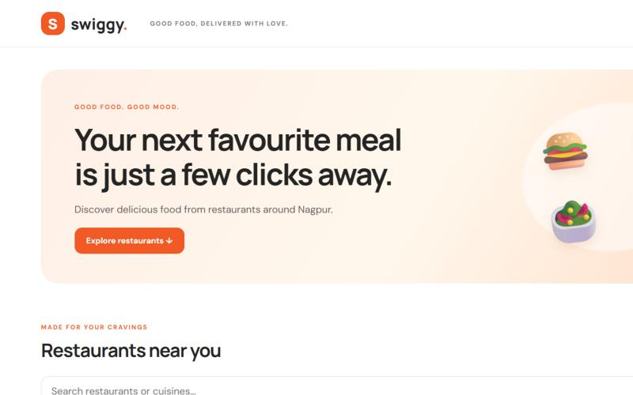
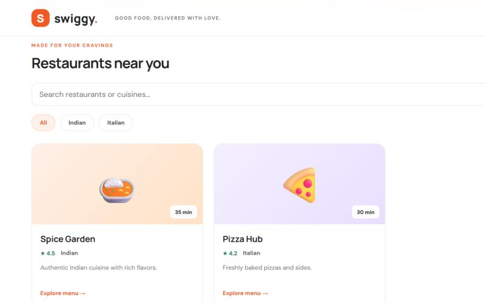
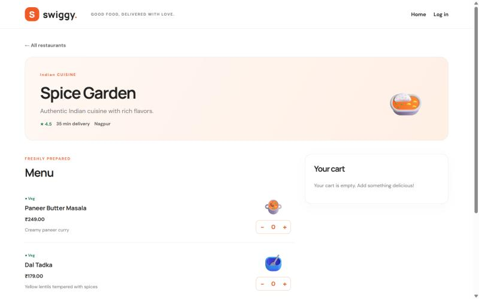

# AWS deployment record

The app ran on AWS on 8 November 2026, deployed from this repository with no manual steps on the server:

1. **Terraform** created a VPC, subnet, security group and an encrypted `t3.small` EC2 server in Sydney (`ap-southeast-2`).
2. **Ansible** hardened the server and installed K3s.
3. **`scripts/aws-deploy.sh`** deployed the app images that the app repository's CI built and scanned.

The server is destroyed between sessions to save cost, so the address below no longer works. Run [`scripts/aws-up.sh`](../scripts/aws-up.sh) to bring the same environment back in about 10 minutes.

## The website, served from EC2

| Home | Restaurants | Menu |
|---|---|---|
|  |  |  |

## Checks run from the public internet

| Check | Result |
|---|---|
| Home page | 200, served by Nginx through Traefik |
| `GET /api/restaurants` | 2 restaurants |
| Open an order without logging in | 401 |
| Restaurant ID that is not a number | 400 |
| Register, place an order, view it | Works |
| Customer opens the staff dashboard | 403 |
| Customer cancels their new order | 200 |
| Customer cancels it again | 403 (only `PLACED` orders can be cancelled by a customer) |
| Kubernetes API, port 6443, from the admin address | Answers, requires login (401) |
| Backend port 3000 from outside | No answer; not exposed |

Test accounts and orders were deleted afterwards.

## Command output

### Terraform

```console
$ terraform apply swiggy.tfplan
...
Apply complete! Resources: 14 added, 0 changed, 0 destroyed.

$ terraform output
server_public_ip = "54.66.48.104"
ssh_command = "ssh ec2-user@54.66.48.104"
website_url = "http://54.66.48.104"

$ aws ec2 describe-instances (swiggy-k3s-server)
+-----------+-----------------------+
|  IMDSv2   |  required             |
|  Id       |  i-03a92201908686d93  |
|  PublicIp |  54.66.48.104         |
|  State    |  running              |
|  Type     |  t3.small             |
|  Zone     |  ap-southeast-2a      |
+-----------+-----------------------+
```

### Ansible

```console
$ ansible-playbook playbooks/site.yml          # first run
swiggy-aws : ok=19   changed=15   unreachable=0   failed=0

$ ansible-playbook playbooks/site.yml          # second run: nothing left to change
swiggy-aws : ok=15   changed=0    unreachable=0   failed=0   skipped=1
```

Verified on the server afterwards:

| Setting | Value |
|---|---|
| `PermitRootLogin` / `PasswordAuthentication` | `no` / `no` (root SSH attempt was refused) |
| `dnf-automatic.timer` | enabled, installs security updates daily |
| K3s Secrets encryption at rest | Enabled |
| Instance metadata without a token (IMDSv1) | Refused, 401 |

### Kubernetes

```console
$ kubectl get nodes -o wide
NAME                                             STATUS   ROLES           VERSION        OS-IMAGE
ip-10-20-1-201.ap-southeast-2.compute.internal   Ready    control-plane   v1.36.6+k3s1   Amazon Linux 2023.12.20261102

$ kubectl -n swiggy get pods,svc,ingress
NAME                            READY   STATUS    RESTARTS   AGE
pod/backend-6fc768b676-4qljv    1/1     Running   0          24m
pod/backend-6fc768b676-q4cfb    1/1     Running   0          24m
pod/frontend-54779998c9-h8kvr   1/1     Running   0          24m
pod/frontend-54779998c9-mwrwg   1/1     Running   0          24m
pod/postgres-0                  1/1     Running   0          24m

NAME               TYPE        CLUSTER-IP     PORT(S)
service/backend    ClusterIP   10.43.197.53   3000/TCP
service/frontend   ClusterIP   10.43.34.191   8080/TCP
service/postgres   ClusterIP   None           5432/TCP

NAME                               CLASS     HOSTS   ADDRESS       PORTS
ingress.networking.k8s.io/swiggy   traefik   *       10.20.1.201   80

$ kubectl -n swiggy get networkpolicy
NAME                          POD-SELECTOR
allow-backend-from-frontend   app.kubernetes.io/name=backend
allow-frontend                app.kubernetes.io/name=frontend
allow-postgres-from-backend   app.kubernetes.io/name=postgres
default-deny-ingress          <none>

$ kubectl get namespace swiggy -o jsonpath='{.metadata.labels}'
"pod-security.kubernetes.io/enforce":"restricted"

$ k3s secrets-encrypt status
Encryption Status: Enabled
```

### From the internet

```console
$ curl -sI http://54.66.48.104/
HTTP/1.1 200 OK
Content-Type: text/html
Server: nginx/1.30.6

$ curl -s http://54.66.48.104/api/restaurants
1 Spice Garden - Indian
2 Pizza Hub - Italian
```
